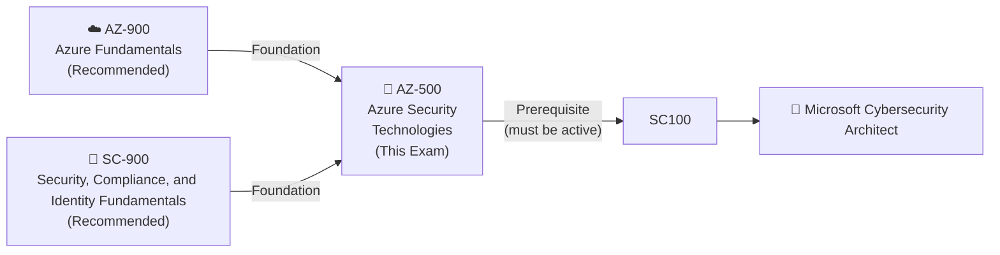

# 🔐 AZ-500: Microsoft Azure Security Technologies
### Study Notes Repository

[](https://marcogrimaldi29.com/az-500-study-notes/)
[](https://marcogrimaldi29.com)

> 🎯 **Goal:** Earn the Microsoft Certified: Azure Security Engineer Associate badge
> 📅 **Notes Version:** 2026
> 🌐 **Published site:** [📘 AZ-500 Study Notes](https://marcogrimaldi29.com/az-500-study-notes/)
> ✍️ **Author:** [Marco Grimaldi](https://www.linkedin.com/in/marco-grimaldi29/)

---

## 📋 Exam At-a-Glance

| Detail | Info |
|--------|------|
| 🏅 Certification | Microsoft Certified: Azure Security Engineer Associate |
| 📝 Passing Score | **700 / 1000** |
| 💶 Exam Price | **~€126 EUR** *(varies by region; VAT may apply)* |
| ⏱️ Duration | **~100 minutes** |
| ❓ Question Types | MCQ, multi-select, drag-and-drop, case studies |
| 🔁 Renewal | **Annual** via free online assessment on Microsoft Learn |

---

## 📊 Official Domain Breakdown

```
pie title AZ-500 Exam Domain Weights
    "Secure Identity & Access (15–20%)" : 20
    "Secure Networking (20–25%)" : 25
    "Secure Compute, Storage & Databases (20–25%)" : 25
    "Defender for Cloud & Sentinel (30–35%)" : 30
```

| # | Domain | Official Weight | Key Services |
|---|---------|----------------|--------------|
| 1 | Secure Identity & Access | **15–20%** | Entra ID, PIM, MFA, Conditional Access, Managed Identities |
| 2 | Secure Networking | **20–25%** | NSG, ASG, Firewall, WAF, Private Endpoint, DDoS |
| 3 | Secure Compute, Storage & Databases | **20–25%** | ADE, AKS, ACR, TDE, Key Vault, SQL Auditing |
| 4 | Defender for Cloud & Microsoft Sentinel | **30–35%** | Defender plans, Secure Score, SIEM, SOAR, Automation |

> 🔑 **Domain 4 = heaviest domain** — allocate ≥35% of total study time here.

---

## 🗺️ Certification Path


---

## 🗂️ Repository Structure

```
az-500-study-notes/
├── README.md                             ← 📍 You are here
├── index.md                              ← GitHub Pages home
├── 00-azure-security-fundamentals.md     ← Core security concepts & Zero Trust
├── 01-identity-access.md                 ← Domain 1: Identity & Access (15–20%)
├── 02-secure-networking.md               ← Domain 2: Secure Networking (20–25%)
├── 03-compute-storage-databases.md       ← Domain 3: Compute/Storage/DB (20–25%)
├── 04-defender-sentinel.md               ← Domain 4: Defender + Sentinel (30–35%)
└── 05-quick-reference-cheatsheet.md      ← Last-minute review & exam traps
```

---

## 📚 Official Learning Resources

| Resource | Link |
|----------|------|
| 📄 Official Exam Page | [AZ-500 Exam](https://learn.microsoft.com/en-us/credentials/certifications/azure-security-engineer/) |
| 📋 Study Guide | [Official Study Guide](https://learn.microsoft.com/en-us/credentials/certifications/resources/study-guides/az-500) |
| 🧪 Free Practice Assessment | [Practice Assessment](https://learn.microsoft.com/en-us/credentials/certifications/azure-security-engineer/practice/assessment?assessment-type=practice&assessmentId=57) |
| 🎬 Exam Readiness Videos | [Exam Readiness Zone](https://learn.microsoft.com/en-us/shows/exam-readiness-zone/?terms=AZ-500) |
| 🔐 Microsoft Defender for Cloud | [Defender Docs](https://learn.microsoft.com/en-us/azure/defender-for-cloud/) |
| 🗡️ Microsoft Sentinel | [Sentinel Docs](https://learn.microsoft.com/en-us/azure/sentinel/) |
| 🏛️ Azure Security Benchmark | [MCSB](https://learn.microsoft.com/en-us/security/benchmark/azure/) |

---

### ✅ Key Study Tips

- 🎯 The exam tests **"why this control?"** — think in threat models and defence-in-depth layers
- 🔄 Understand **Zero Trust principles** — verify explicitly, least privilege, assume breach
- 🔑 Know **Key Vault tiers** (Standard vs Premium/HSM) and when to use each
- 🛡️ **Defender for Cloud Secure Score** is heavily tested — know how to interpret & improve it
- 📊 Memorise **RBAC built-in roles** vs custom roles, and when each is appropriate
- 🌐 Know **all Private Endpoint vs Service Endpoint trade-offs** — scenario questions test these
- 🔍 Understand **Microsoft Sentinel analytics rule types** (Scheduled, NRT, Fusion, etc.)
- ⚡ **PIM** — know the difference between eligible, active, and permanent assignments

---

## 📚 About the Study Notes

These notes are hosted on **GitHub Pages** and published as a searchable website on this URL:

👉 **[📘 AZ-500 Study Notes](https://marcogrimaldi29.com/az-500-study-notes/)**

The site includes full-text search, Mermaid diagram rendering, and mobile-friendly navigation for on-the-go review. 

These notes are designed to be a structured, exam-focused summary of the most important concepts and services baseds on the official [Microsoft AZ-500 Study Guide](https://learn.microsoft.com/en-us/credentials/certifications/resources/study-guides/az-500) and its criteria.

Additional study notes maintained by me are also available for those pursuing Microsoft and Azure certifications at the following Landing Page:

👉 **[🛬 Landing Page: Study Notes](https://marcogrimaldi29.com/study-notes/)**

---

## ✍️ About the Author

Maintained by **[Marco Grimaldi](https://www.linkedin.com/in/marco-grimaldi29/)** — Cloud Consultant, Language Trainer & Lifelong Learner.

Find more certification guides, study tips, and tech content at **[🏠 marcogrimaldi29.com](https://marcogrimaldi29.com)**

The site is continuously updated and based on my personal study notes and experiences. If you have any feedback, suggestions, or corrections, feel free to [reach out](https://marcogrimaldi29.com/contact/)!

---

## 📈 Analytics

This site uses [Umami](https://umami.is/) for privacy-friendly analytics.

---

## 🐞 Spotted a Mistake?

Azure security services change fast, so if something here is wrong or out of date, please [report an issue](https://github.com/marcogrimaldi29/az-500-study-notes/issues).

---

## 💚 Support

If these notes helped you prepare for AZ-500, there are a couple of ways to show it: ⭐ star this repo on GitHub so other candidates can find it, or 🤝 connect with me on LinkedIn.

<p>
  <a href="https://github.com/marcogrimaldi29/az-500-study-notes"></a>
  <a href="https://www.linkedin.com/in/marco-grimaldi29/"></a>
</p>

---

## ©️ Credits & Acknowledgements

The **[Just the Docs](https://github.com/just-the-docs/just-the-docs)** theme is used for a clean documentation-style layout. Licensed under [MIT](https://opensource.org/license/MIT).

**[Claude Sonnet 4.6](https://www.anthropic.com/news/claude-sonnet-4-6)** was used for initial content generation; all final edits, fact-checking, and formatting by the author.

> *Not affiliated with or endorsed by Microsoft. Always verify against the latest Microsoft documentation.*
