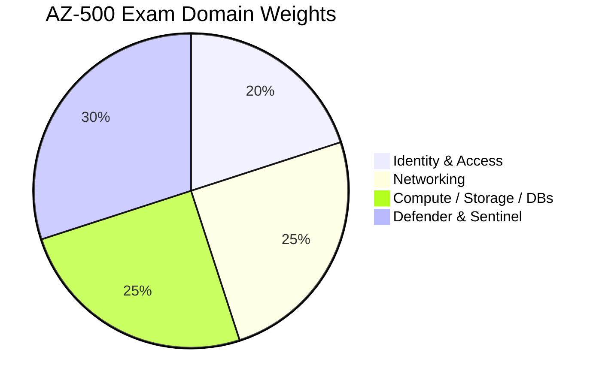

# 📘 AZ-500 Study Notes
{: .fs-9 }

Study Notes & Exam Prep for the **Microsoft Certified: Azure Security Engineer Associate** certification (AZ-500, retired 31 August 2026).
{: .fs-6 .fw-300 }

{: .retired }
**AZ-500 retired on 31 August 2026** and can no longer be taken or renewed. These notes stay online as a reference. The successor is **SC-500 (Microsoft Certified: Cloud and AI Security Engineer Associate)**; see [Retirement & Successor](#retirement-and-successor) below.

[View on GitHub](https://github.com/marcogrimaldi29/az-500-study-notes){: .btn .fs-5 .mb-4 .mb-md-0 }

[Get Started →](){: .btn .btn-primary .fs-5 .mb-4 .mb-md-0 .mr-2 }
[AZ-500 Page (retired)](https://learn.microsoft.com/en-us/credentials/certifications/azure-security-engineer/){: .btn .fs-5 .mb-4 .mb-md-0 .mr-2 }
[SC-500 (successor)](https://learn.microsoft.com/en-us/credentials/certifications/cloud-and-ai-security-engineer-associate/){: .btn .fs-5 .mb-4 .mb-md-0 }

---

> These notes are maintained by **[Marco Grimaldi](https://www.linkedin.com/in/marco-grimaldi29/)** and based on the **[official Microsoft documentation](https://learn.microsoft.com/en-us/credentials/certifications/azure-security-engineer/)**.
> Find more certification guides, study tips, and tech content at **[🏠 marcogrimaldi29.com](https://marcogrimaldi29.com)**.
> *Not affiliated with or endorsed by Microsoft. Always verify against the latest Microsoft documentation.*

---

## 📊 AZ-500 Exam Domain Weights (final)

Weights from the final AZ-500 skills outline (updated 22 January 2026), which these notes follow.

| Domain | Weight |
|--------|--------|
| 🪪 Secure Identity & Access | **15–20%** |
| 🌐 Secure Networking | **20–25%** |
| 💾 Secure Compute, Storage & Databases | **20–25%** |
| 🛡️ Defender for Cloud & Microsoft Sentinel | **30–35%** |

---

## 🗺️ Quick Navigation

| # | File | Domain | Weight |
|---|------|---------|--------|
| 0 | [🔰 Azure Security Fundamentals]() | Zero Trust, MCSB, Defence in Depth | — |
| 1 | [🪪 Identity & Access]() | Entra ID, PIM, MFA, Conditional Access | 15–20% |
| 2 | [🌐 Secure Networking]() | NSG, Firewall, WAF, Private Endpoints | 20–25% |
| 3 | [💾 Compute, Storage & Databases]() | AKS, ADE, TDE, Key Vault, SQL | 20–25% |
| 4 | [🛡️ Defender for Cloud & Sentinel]() | Defender plans, Secure Score, SIEM/SOAR | 30–35% |
| 5 | [⚡ Quick Reference Cheatsheet]() | Key facts, exam traps, final checklist | All |

---

## 🗄️ Retirement & Successor (SC-500) {#retirement-and-successor}

Microsoft retired the AZ-500 exam, the **Microsoft Certified: Azure Security Engineer Associate** certification and its renewal assessment on **31 August 2026 at 11:59 PM Central Standard Time**. The direct replacement is **Exam SC-500: Implementing End-to-End Security Controls for Cloud and AI Workloads**, which earns the **Microsoft Certified: Cloud and AI Security Engineer Associate** certification.

| Date | Event |
|------|-------|
| 22 January 2026 | Final AZ-500 skills-outline update (the version these notes follow) |
| May 2026 | SC-500 beta exam opens |
| 21 July 2026 | SC-500 certification generally available |
| 31 August 2026 | AZ-500 exam, certification and renewal assessment retired |

### If you already hold AZ-500

- Your certification stays valid, and on your Microsoft Learn transcript, until its expiry date. Retirement doesn't revoke it.
- You can't renew it anymore. When it expires, earning the new certification means passing SC-500.

### SC-500 at a glance

| SC-500 domain | Weight | Closest notes here |
|---------------|--------|--------------------|
| Manage identity, access, and governance | **20–25%** | [01 — Identity & Access](), Azure Policy and Key Vault in [04]() |
| Secure storage, databases, and networking | **25–30%** | [02 — Secure Networking](), storage and SQL in [03]() |
| Secure compute (now includes **security for AI**) | **20–25%** | VMs, AKS and containers in [03]() |
| Manage and monitor security posture | **20–25%** | [04 — Defender for Cloud & Sentinel]() |

**New in SC-500, not covered by these notes:**

- **Security for AI:** Microsoft Purview Data Security Posture Management (DSPM) for Copilot and AI apps, Defender for AI Services, the Data and AI security dashboard in Defender for Cloud, agent guardrails in Microsoft Foundry, and AI Gateway in Azure API Management
- **Agents:** Conditional Access and access management for Microsoft Entra Agent ID, real-time protection for Copilot Studio agents, and managing agents in the Microsoft 365 admin center
- **Microsoft Security Copilot:** workspaces, roles, plugins and agents
- **Networking:** Microsoft Entra Private Access
- **Governance:** resource locks, security controls through infrastructure as code, and remediating overprivileged RBAC assignments
- **Servers:** Azure Arc for hybrid and multicloud servers, VM security features (secure boot, vTPM), and Azure Machine Configuration
- **Sentinel and XDR:** workspace setup and roles, content hub, custom log tables, data retention, and querying Microsoft Purview Audit in Defender XDR

**No longer named as separate objectives** (related topics can still appear): DDoS Protection, Azure Front Door and CDN, Application Gateway, ExpressRoute encryption, user-defined routes, VNet peering, App Service Environment, Dynamic Data Masking, Always Encrypted, TDE, BYOK and double encryption for storage, and Defender for Cloud DevOps security connectors.

### Cybersecurity Architect Expert (SC-100) prerequisite

AZ-500 used to be one of the three prerequisite options for **Microsoft Certified: Cybersecurity Architect Expert**. The certification page now lists SC-500 instead: alongside the SC-100 exam, you need **one of** SC-300 (Identity and Access Administrator), SC-200 (Security Operations Analyst) or **SC-500** (Cloud and AI Security Engineer).

### Official sources

- [AZ-500 study guide](https://learn.microsoft.com/en-us/credentials/certifications/resources/study-guides/az-500) (retirement notice)
- [Microsoft Certified: Azure Security Engineer Associate](https://learn.microsoft.com/en-us/credentials/certifications/azure-security-engineer/) (retired certification)
- [Microsoft Certified: Cloud and AI Security Engineer Associate](https://learn.microsoft.com/en-us/credentials/certifications/cloud-and-ai-security-engineer-associate/)
- [SC-500 study guide](https://learn.microsoft.com/en-us/credentials/certifications/resources/study-guides/sc-500)
- [Cybersecurity Architect Expert prerequisites](https://learn.microsoft.com/en-us/credentials/certifications/cybersecurity-architect-expert/#certification-prerequisites)
- [Exam and assessment lab retirement](https://learn.microsoft.com/en-us/credentials/support/retired-certification-exams)
- [Microsoft Skills Hub announcement](https://techcommunity.microsoft.com/blog/skills-hub-blog/the-ai-job-boom-is-here-are-you-ready-to-showcase-your-skills/4494128)

---

## 📚 About the Study Notes

The site includes full-text search, Mermaid diagram rendering, and mobile-friendly navigation for on-the-go review. 

These notes are designed to be a structured, exam-focused summary of the most important concepts and services based on the official **[Microsoft AZ-500 Study Guide](https://learn.microsoft.com/en-us/credentials/certifications/resources/study-guides/az-500)** and its criteria. They follow the final AZ-500 skills outline (22 January 2026) and are kept as an archived reference now that the exam has retired.

Additional study notes maintained by me are also available for those pursuing Microsoft and Azure certifications at the following Landing Page:

👉 **[🛬 Landing Page: Study Notes](https://marcogrimaldi29.com/study-notes/)**

---

## ✍️ About the Author

These notes are maintained by **[Marco Grimaldi](https://www.linkedin.com/in/marco-grimaldi29/)** — Cloud Consultant, Language Trainer & Lifelong Learner.

📍 **Find more content at [🏠 marcogrimaldi29.com](https://marcogrimaldi29.com)**

> The website is continuously updated and based on my personal study notes and experiences. If you have any feedback, suggestions, or corrections, feel free to [reach out](https://marcogrimaldi29.com/contact/)!

---

## 📈 Analytics

This site uses [Umami](https://umami.is/) for privacy-friendly analytics.

---

## ©️ Credits & Acknowledgements

The [Just the Docs](https://github.com/just-the-docs/just-the-docs) theme is used for a clean, documentation-style layout. Licensed under [MIT](https://opensource.org/license/MIT).

Created with the help of AI. Model used: [Claude Sonnet 4.6](https://www.anthropic.com/news/claude-sonnet-4-6). The content has been reviewed and edited by the author for accuracy and clarity, but may contain errors. Always verify against the latest [Microsoft documentation](https://learn.microsoft.com/en-us/azure/).

> *Not affiliated with or endorsed by Microsoft.*